<p align="center">
  
</p>

Every hour, backlog-agent goes through each of my GitHub repos. It fixes what it
can fix alone, turns the rest into cards on one Linear board, and asks me only
for the decisions that need me: approving a plan and reviewing a pull request.

It handles four kinds of work:

- **Dependency and security work.** It handles Dependabot PRs, security alerts,
  red default branches and repos with no CI from start to finish. It only needs
  me when a task ends blocked or in review.
- **The backlog.** Every open issue gets a card. The agent reproduces and
  diagnoses an issue, then proposes a plan for one small part of it. Once I
  approve the plan, it builds exactly that and opens a pull request.
- **Scans.** For work nobody filed, it reviews each of my repos that is not a
  fork, and again when its default branch has moved, at most once a week. It
  files up to three findings as issues. They wait in the backlog like any other
  issue, and it stops scanning while three are open. A repo nobody has touched
  for a month gets one scan too.
- **Its own docs.** After any hour with something to report, a steward runs last
  and fixes the spec, the glossary and the prompts wherever they no longer match
  what happened.

## The crew

<p align="center">
  
</p>

Each agent in a run has its own scrubber:

| Scrubber | Agent                       | Follows                                  |
| -------- | --------------------------- | ---------------------------------------- |
| Foreman  | the hourly dispatcher       | [`PROMPT.md`](backlog-agent/PROMPT.md)   |
| Patch    | a child on dependency work  | [`CHILD.md`](backlog-agent/CHILD.md)     |
| Probe    | a child on a triage or scan | [`CHILD.md`](backlog-agent/CHILD.md)     |
| Rivet    | a child on a build run      | [`CHILD.md`](backlog-agent/CHILD.md)     |
| Ledger   | the steward                 | [`STEWARD.md`](backlog-agent/STEWARD.md) |

They all show their state the same way, with the eyes and the beacon on top:

<p align="center">
  
</p>

## One hour

<p align="center">
  
</p>

The model doesn't make the decisions. [`backlog.py`](backlog-agent/backlog.py)
holds every rule: ranking, holds, caps, retries, the ledger and the triage state
machine. Unit tests cover all of it. The hourly dispatcher
([`PROMPT.md`](backlog-agent/PROMPT.md)) runs `backlog.py`, applies the card
moves it decides, and starts the children it names one at a time
([`CHILD.md`](backlog-agent/CHILD.md)). It then hands off to the steward
([`STEWARD.md`](backlog-agent/STEWARD.md)). An hour with nothing to report stays
silent.

## A card's journey

<p align="center">
  
</p>

Only two steps are mine: dragging a card to **Approved** and merging the pull
request. The agent moves the card everywhere else. A triage run can also end in
one of these other ways:

| The run ends with                     | The card goes to                    |
| ------------------------------------- | ----------------------------------- |
| a fix PR, for a bug I sent to triage  | In Review                           |
| a question, or no way to reproduce it | Needs info, labeled `needs-repro`   |
| a diagnosis but no safe fix           | Needs info, labeled `unable-to-fix` |
| a crash, twice                        | Needs info, labeled `failed`        |
| a finding that it's not actionable    | Canceled                            |

To answer a question, I comment on the issue, and the card goes back to triage
the next hour. When nothing waits for me, the agent picks the best untriaged
issues itself, security first, then bugs, oldest first. It stops once three
plans wait for my approval.

## Guardrails

- Only my drag from Needs approval to Approved counts as approval. The agent
  undoes that move when anyone else makes it
  ([ADR 0002](docs/adr/0002-agent-has-its-own-linear-identity.md)).
- Only text I wrote can start or steer a run. Issues and comments from anyone
  else, bots included, wait in Backlog until I move them.
- A scan changes no code in the repo it reviews. It only files issues, and each
  one is marked as the agent's, so it can never start a run the way an issue I
  wrote does. When it drafts a tool profile for a stack the skill doesn't know,
  it may open a pull request on nix-config for me to review.
- Children never write to Linear. Only `backlog.py` writes, through the agent's
  own OAuth app, so a card's history always shows who moved it.
- Build PRs are labeled `needs-review`, assigned to me, and never auto-merge.
- At most 3 runs at once and 100 a day, shared by all work. Dependency work
  always ranks above triage and build runs.
- A crashed run is retried once, then parked for me.

## Health checks

The run report shows whether work is moving, not how much is left:

1. no Dependabot PR or alert left unhandled
2. no card waiting more than 24h in Needs triage or Approved
3. at most 3 cards the agent picked itself waiting in Needs approval
4. no card in In Review for more than 7 days
5. every default branch has green CI

## Scope

A repo is in scope when it is mine (`jakob1379`), not archived, and not a fork.
A fork comes into scope when I add the `backlog-agent` topic to it. Repos in
other orgs never count. The same rule applies to dependency work and to the
backlog.

## Where it's going

The agent started with what had already been filed: dependency updates and the
issues I've written. Scans are the first step past that. They run the
`aggregate-code-quality-report` skill from my nix-config, which this repo's
flake pins as `.#skills` (the plugin skills its lanes call are not pinned);
`nix flake update nix-config` moves the agent to a newer copy. New kinds of work
plug in the way triage and scans did: a task kind in `backlog.py`, a section in
`CHILD.md`, and the same caps, ledger and approval gate.

## Working on it

```bash
nix develop                                   # python3, gh, git; installs the git hooks
nix fmt                                       # run every hook on every file
cd backlog-agent && python3 -m unittest       # gate for every rule change
```

The hooks ([`nix/git-hooks.nix`](nix/git-hooks.nix)) run on every commit in
every worktree, including the agent's own. Betterleaks scans each staged change,
and the full history before each push. A guard refuses the ledger, lockfiles,
`gh-token`, `linear-client` and `.env` files. Commit messages must be
conventional commits.

| Command                                   | Does                                                         |
| ----------------------------------------- | ------------------------------------------------------------ |
| `backlog.py collect`                      | reads the in-scope repos and, with credentials, the board    |
| `backlog.py plan <candidates> <thread>`   | decides dispatch, card moves and health; claims tasks        |
| `backlog.py apply <plan>`                 | makes the card moves on the board under its rate limits      |
| `backlog.py start <key> <task_id>`        | records a started child                                      |
| `backlog.py finish <key> <status> <note>` | records its outcome (`-` reads the note from stdin)          |
| `backlog.py running`                      | lists running tasks and whether they're overdue              |
| `backlog.py board`                        | prints the board as JSON                                     |
| `backlog.py setup`                        | one-off: adds statuses and labels, marks imported duplicates |

The agent reads its credentials from `~/.config/backlog-agent/` (`gh-token`, and
`linear-client` for the board). The ledger and `work/` are local and ignored by
git.

Before changing a rule, read the [glossary](backlog-agent/GLOSSARY.md), the
[design](docs/superpowers/specs/2026-11-21-backlog-agent-design.md), and ADRs
[0001](docs/adr/0001-triage-state-machine-lives-in-the-agent.md),
[0002](docs/adr/0002-agent-has-its-own-linear-identity.md) and
[0003](docs/adr/0003-scan-findings-are-marked-github-issues.md).
